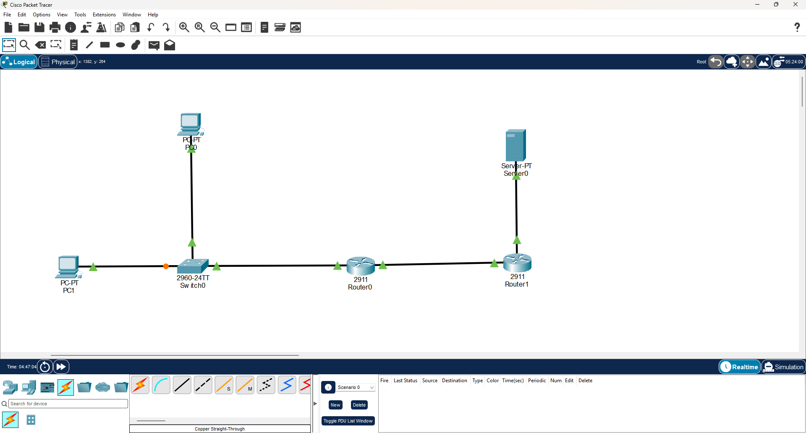
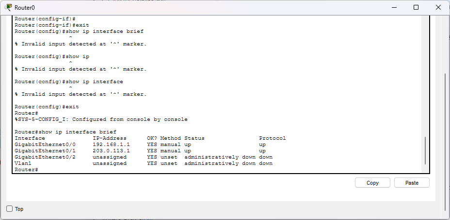
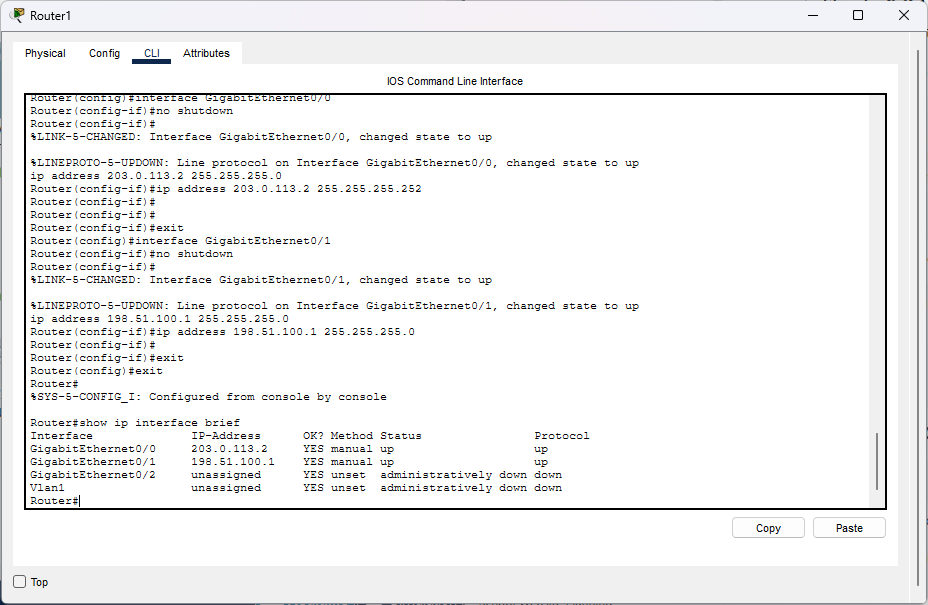
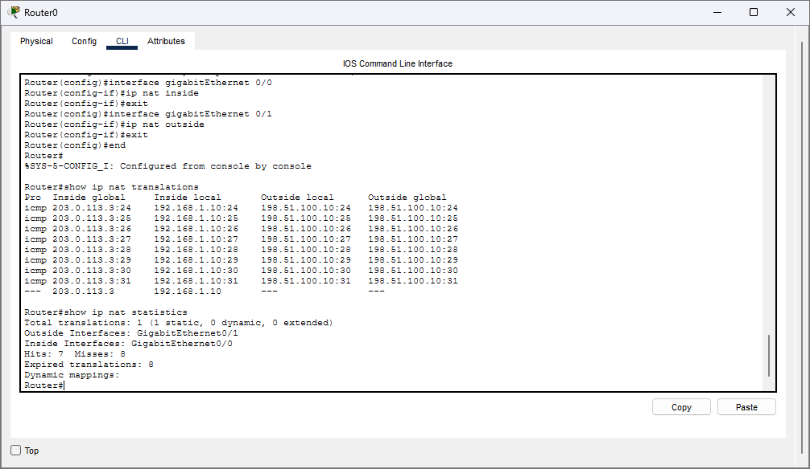
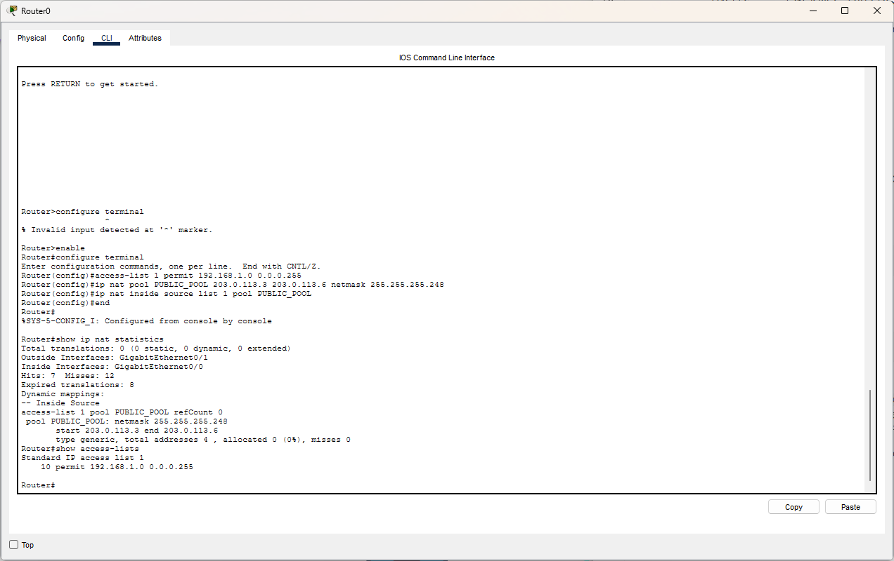
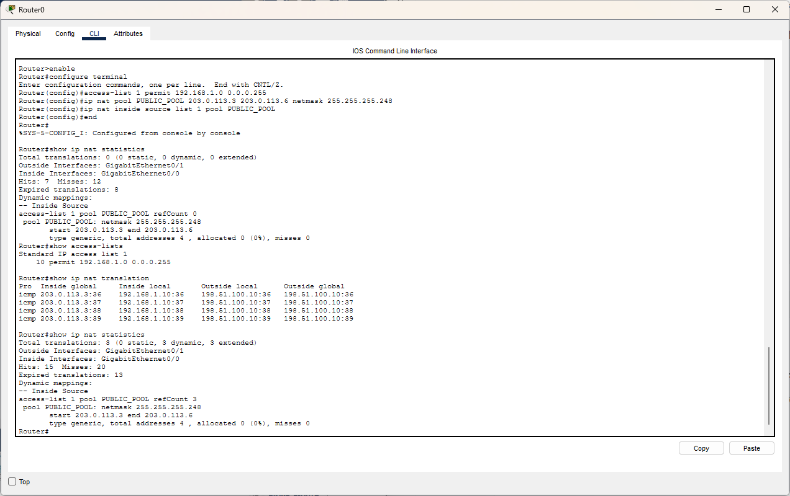
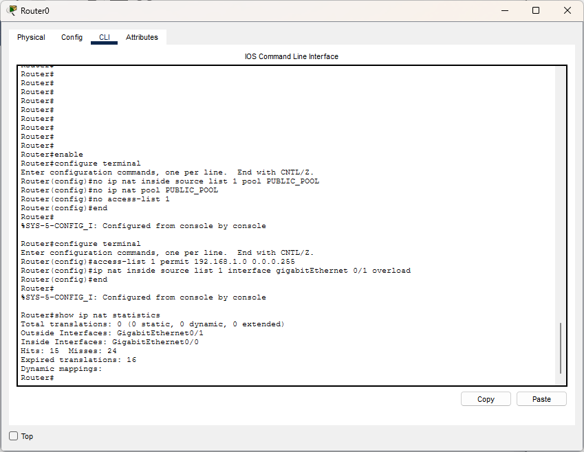
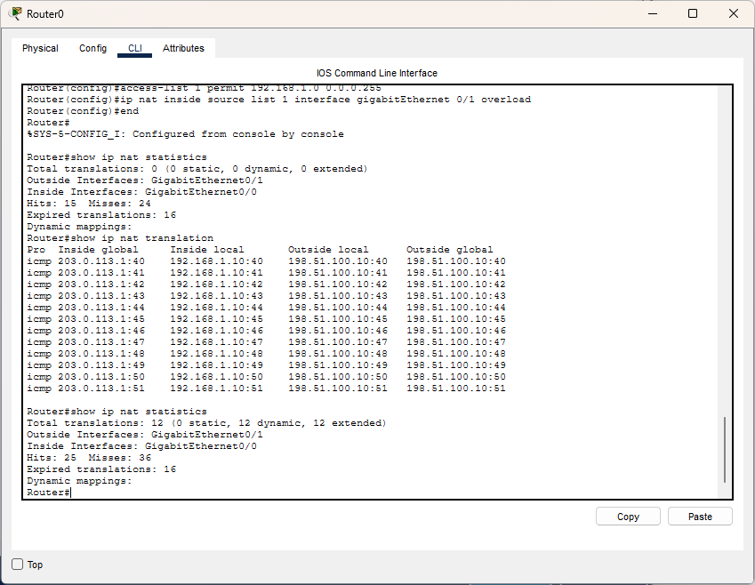
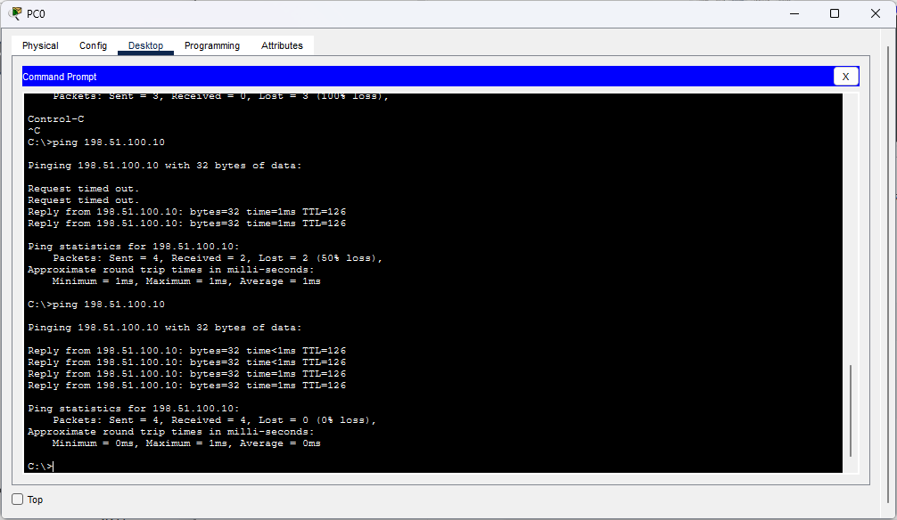

# Lab 08 — NAT & PAT

## Overview

This lab demonstrates Network Address Translation (NAT) and Port Address Translation (PAT) using Cisco Packet Tracer.

The practical covers Static NAT, Dynamic NAT, PAT (NAT Overload), NAT translation tables, and connectivity verification.

## Objectives

- Understand the purpose of NAT in IPv4 networks.
- Configure Static NAT for a fixed one-to-one address mapping.
- Configure Dynamic NAT using an address pool.
- Configure PAT to allow multiple inside hosts to share an outside interface address.
- Verify translations using Cisco IOS commands.
- Test connectivity between the inside and outside networks.

## Network Topology

The topology contains:

- Router0 — NAT router
- Router1 — outside network router
- Switch0 — connects the inside LAN devices
- PC0 and PC1 — inside LAN hosts
- Server0 — outside network host

**Topology:** Inside PCs → Switch0 → Router0 → Router1 → Server0



## IP Addressing

The following addresses were observed in the Packet Tracer configuration screenshots.

| Device | Interface | IP Address | Subnet Mask |
|---|---|---|---|
| Router0 | GigabitEthernet0/0 | 192.168.1.1 | 255.255.255.0 |
| Router0 | GigabitEthernet0/1 | 203.0.113.1 | 255.255.255.252 |
| Router1 | GigabitEthernet0/0 | 203.0.113.2 | 255.255.255.252 |
| Router1 | GigabitEthernet0/1 | 198.51.100.1 | 255.255.255.0 |
| Inside host | — | 192.168.1.10 | Verify in Packet Tracer |
| Outside server | — | 198.51.100.10 | Verify in Packet Tracer |

> **Addressing note:** The Dynamic NAT pool was configured with `203.0.113.3–203.0.113.6` and mask `255.255.255.248` in the captured CLI output. This pool does not match the directly connected `203.0.113.0/30` router link. Verify the public pool, routing, and address allocation before treating the final configuration as complete.

The `203.0.113.0/24` and `198.51.100.0/24` networks are reserved for documentation and examples; they are suitable for a simulated lab, not real Internet addressing.

## NAT Address Terminology

- **Inside Local:** The private address of an inside host, such as `192.168.1.10`.
- **Inside Global:** The address used to represent that inside host to the outside network.
- **Outside Local:** The outside host's address as represented to the inside network.
- **Outside Global:** The address assigned to the outside host.

## Types of NAT

### 1. Static NAT

Static NAT provides a fixed one-to-one mapping between an inside local address and an inside global address.

Example command:

```text
ip nat inside source static 192.168.1.10 203.0.113.3
```

Verification:

```text
show ip nat translations
show ip nat statistics
```

Evidence: `04-static-nat-translation.png`

### 2. Dynamic NAT

Dynamic NAT allocates inside global addresses from a configured pool when eligible inside hosts initiate traffic.

The following commands were used in the captured configuration:

```text
access-list 1 permit 192.168.1.0 0.0.0.255
ip nat pool PUBLIC_POOL 203.0.113.3 203.0.113.6 netmask 255.255.255.248
ip nat inside source list 1 pool PUBLIC_POOL
```

Verification:

```text
show access-lists
show ip nat translations
show ip nat statistics
```

Evidence:

- `05-dynamic-nat-configuration.png`
- `06-dynamic-nat-translation.png`

### 3. PAT (NAT Overload)

PAT allows multiple inside connections to share an outside address by distinguishing their sessions using transport-layer ports or other protocol-specific identifiers.

Captured configuration:

```text
access-list 1 permit 192.168.1.0 0.0.0.255
ip nat inside source list 1 interface gigabitEthernet 0/1 overload
```

The NAT router interfaces must also be assigned the correct NAT roles:

```text
interface gigabitEthernet 0/0
 ip nat inside
exit

interface gigabitEthernet 0/1
 ip nat outside
exit
```

Verification:

```text
show ip nat translations
show ip nat statistics
```

Evidence:

- `07-pat-configuration.png`
- `08-pat-translation-table.png`

## Connectivity Verification

Connectivity was tested from a PC using ping commands. The supplied screenshots show successful replies from `192.168.1.1` and `198.51.100.10`.

Evidence: `09-connectivity-verification.png`

## Verification Commands

| Command | Purpose |
|---|---|
| `show ip interface brief` | Check interface IP addresses and status |
| `show running-config` | Inspect the active configuration |
| `show access-lists` | Verify NAT ACL entries |
| `show ip nat translations` | Inspect active NAT translations |
| `show ip nat statistics` | Check NAT statistics and translation counts |
| `ping <IP-address>` | Test reachability |

## Screenshots

## 1. Network Topology


## 2. Router IP Configuration

### Router0



### Router1



## 3. Static NAT



## 4. Dynamic NAT

### Configuration



### Translation Verification



## 5. PAT — NAT Overload

### Configuration



### Translation Table



## 6. Connectivity Verification




## Troubleshooting Notes

During configuration, some IOS commands were entered in the wrong configuration mode, and a Static NAT command initially returned an error. The router prompt and command syntax were corrected during troubleshooting.

Before considering the lab fully verified:

- Confirm the Static NAT mapping appears in `show ip nat translations`.
- Resolve the public address pool and subnet mismatch.
- Confirm the correct inside and outside interface roles.
- Repeat connectivity tests after the final configuration.
- Save the final Packet Tracer file.

## Lab Status

**Status: Practical evidence collected; final configuration verification pending.**

The screenshots demonstrate NAT/PAT configuration attempts, translation output, and connectivity testing. The final address plan and Static NAT mapping must be verified before marking every objective complete.

## Tools Used

- Cisco Packet Tracer
- Cisco IOS CLI
- IPv4 addressing
- NAT and PAT
- Ping and NAT verification commands

## Author

**Sagen Saren**
CCNA Networking Labs \& Practical Documentation
